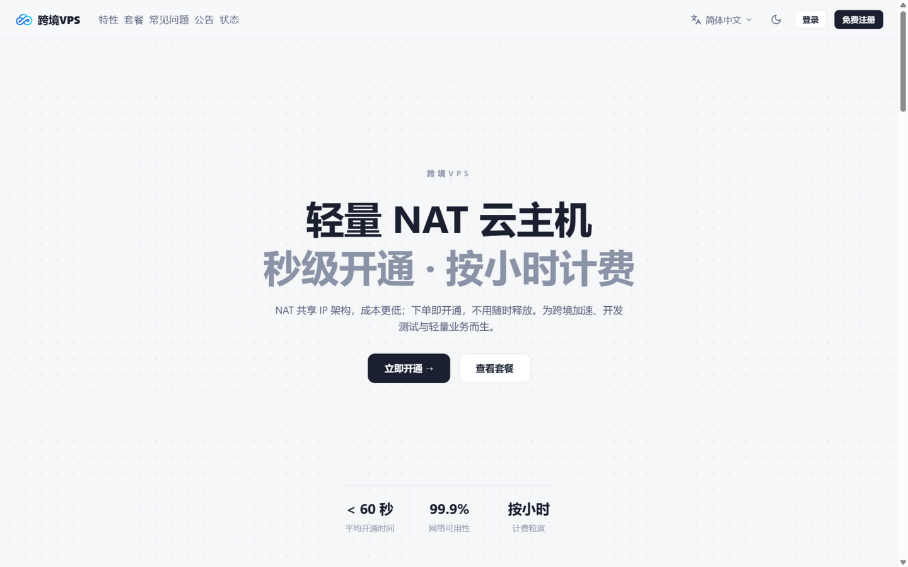
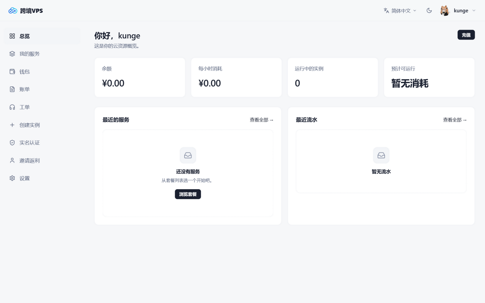
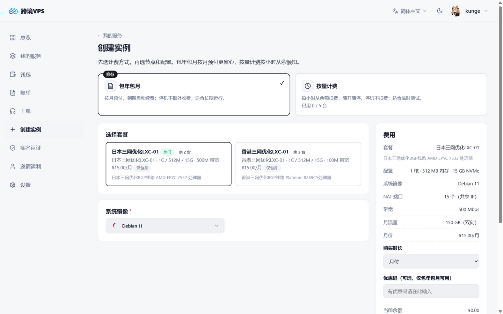
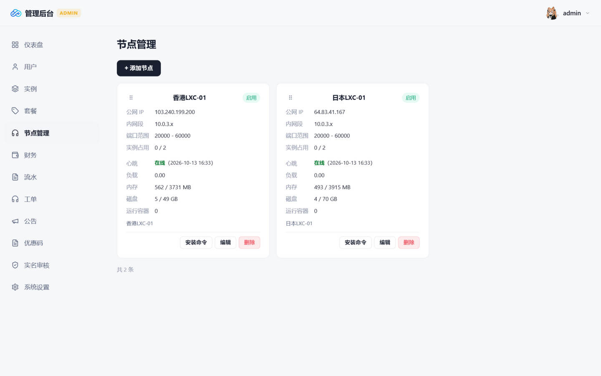
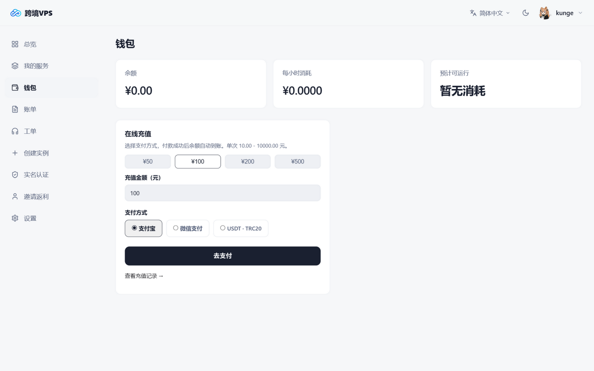
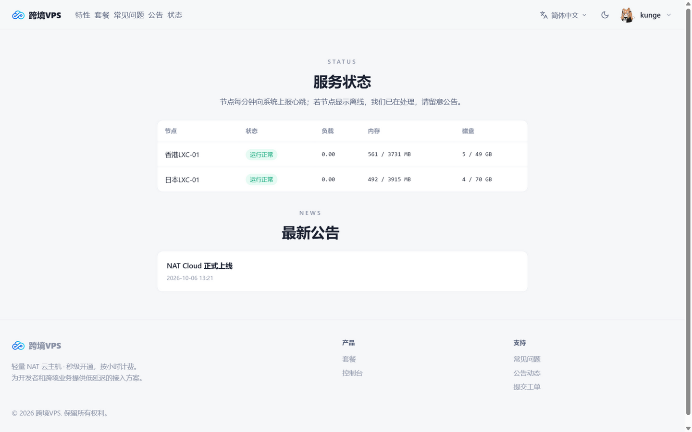
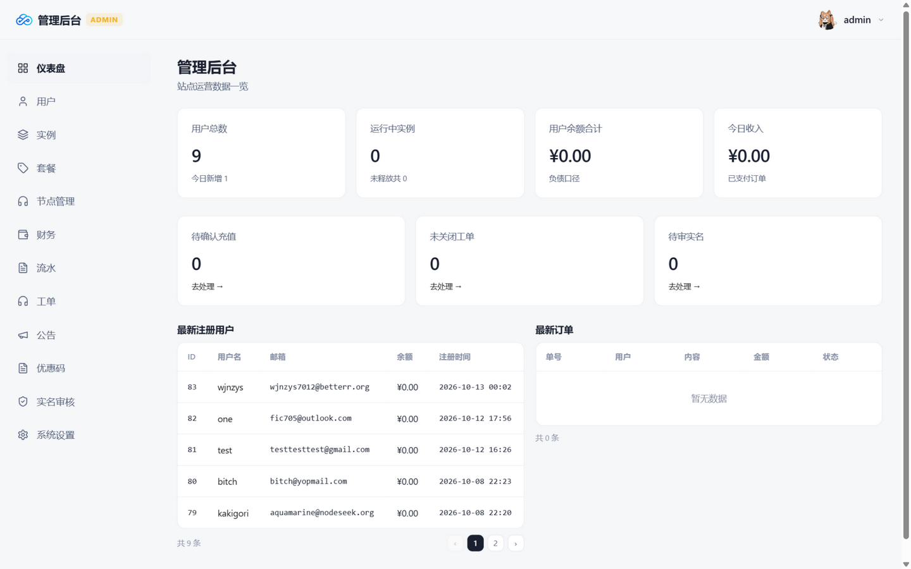

# ☁️ NAT Cloud

**轻量 NAT VPS 销售与自动化开通系统** —— 面向「共享 IP + 独立端口段」NAT 主机业务的完整解决方案：用户下单付款后自动在 LXC 节点创建实例、分配端口段并交付 SSH，全程无需人工介入。

原生 PHP + MySQL，无框架依赖，部署简单，功能均经生产环境长期验证。

<p align="center">
  
</p>

## ✨ 功能一览

**🌐 销售前台**
- 套餐 / 自定义配置两种购买方式，包月 / 季付 / 半年付 / 年付 + 按小时计费
- 优惠码系统（折扣 / 立减、配额、每用户限用一次）
- 推荐返利：专属邀请链接，受邀好友充值后自动按比例返佣
- 公开服务状态页（节点心跳 + 负载 / 内存 / 磁盘实时指标）+ 公告系统
- 到期邮件提醒（7 / 3 / 1 天）、工单回复邮件通知、余额自动续费（可开关）

**🖥️ 用户控制台**
- 实例全生命周期自助管理：开关机 / 重启 / 重装 / 续费（支持批量+优惠码）/ 释放 / 重置密码
- 自助 NAT 端口转发规则、Web VNC 控制台（一次性凭据 + 有效期）
- 邮箱验证注册、找回密码、实名认证（对接第三方人脸核身）、工单（附件 / 优先级）
- Telegram 通知：开通 / 续费 / 到期提醒 / 工单回复实时推送
- 开放 API（Bearer Token）：查询账户与实例、远程开关机

**🛠️ 管理后台**
- 仪表盘 / 用户 / 实例 / 套餐 / 节点 / 财务 / 流水 / 工单 / 公告 / 实名审核 / 优惠码 全模块
- 节点管理：一键安装命令接入、实时资源指标（负载 / 内存 / 磁盘 / 容器数）、心跳在线监测、拖拽排序
- 六套站点主题配色一键切换（石墨 / 深海蓝 / 森林绿 / 罗兰紫 / 落日橙 / 玫瑰红）
- 余额自动续费开关、推荐返利比例、SMTP / 支付 / USDT / Telegram 全部后台可配

<p align="center">
  
</p>
<p align="center">
  
</p>

## 🖥️ 节点架构

```
┌─────────────┐   每分钟拉取任务    ┌──────────────┐
│  网站面板    │ ─────────────────> │  LXC 节点 ×N │
│  (PHP/MySQL) │ <───────────────── │  natnode.sh  │
└─────────────┘   回报结果/流量/指标  └──────────────┘
```

- 节点**零常驻进程、零入站端口**：cron 每分钟拉取任务并回报，天然免疫扫描
- 每节点独立通信密钥；实例独立 loop 磁盘 + machine-id + SSH host key，交付即全新
- 容器隔离加固：lxcfs 视图遮蔽、cpuset 绑核、独立内网 IP 与端口段
- 节点一键接入：后台生成安装命令，在全新 Ubuntu 20+ / Debian 11+（KVM/独立服务器）上执行即完成对接

<p align="center">
  
</p>

## 🚀 快速开始

### Linux（坤面板 KunPanel，推荐）

[坤面板 KunPanel](https://github.com/kungec/kunpanel) 是开源免费的轻量级服务器运维面板（Go 单二进制、开箱即用），面板自身一行命令安装：

```bash
curl -fsSL https://raw.githubusercontent.com/kungec/kunpanel/main/scripts/install.sh | bash
```

1. 登录面板，**应用商店**一键安装 PHP 7.4+ 与 MySQL；
2. **网站 → 添加站点**：填域名，类型选 PHP 7.4+，根目录指向站点目录下的 `public`；
3. **数据库**创建 MySQL 库（utf8mb4），**文件管理**上传 [最新 Release](../../releases) 压缩包到站点目录解压；
4. **网站 → 设置 → 伪静态**添加：
   ```nginx
   location / { try_files $uri $uri/ /index.php?$query_string; }
   ```
5. 访问域名进入**安装向导**（环境自检 → 填数据库与管理员 → 完成）；
6. 保存安装完成页展示的**随机管理后台地址**；
7. **计划任务**添加 `cron/bill.php`（每分钟）与 `cron/traffic_reset.php`（每日 00:05）两个 Shell 任务。

### Windows Server 2016+（IIS）

支持 IIS 部署：程序自带 web.config（public/ 与根目录两份）、OS 自适应安装向导与任务计划脚本，详见 [README_INSTALL.md](README_INSTALL.md)。

> 详细图文步骤见 [README_INSTALL.md](README_INSTALL.md)

## 📸 更多界面

<p align="center">
  
</p>
<p align="center">
  
</p>
<p align="center">
  
</p>

## 🔒 安全设计

- CSRF 全表单覆盖、登录限速、图形验证码（GD 缺失自动降级）
- 支付回调验签 + 幂等入账（码支付 MD5 / 支付宝 RSA2 / 微信 APIv3 公钥 + AES-GCM）
- 敏感数据加密存储（APP_KEY 派生）、Cookie httponly+Secure+SameSite、安全响应头
- SQL 全参数化、节点通信密钥隔离、上传白名单、安装向导完成即永久关闭
- 管理后台路径随机化（每套部署不同，可在 `.env` 更换）

## 💰 支持与赞助

- **赞助商**：[跨境VPS](https://www.kjvps.com) —— 感谢对本项目的大力支持 ❤️
- **在线演示站**：[nat.kjvps.com](https://nat.kjvps.com)
- **官方交流 QQ 群**：[307386089](https://qm.qq.com/cgi-bin/qm/qr?group_code=307386089)

## License

[MIT](LICENSE)
